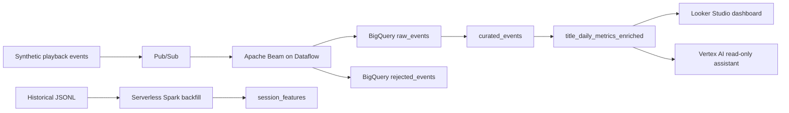

# StreamPulse

Synthetic streaming analytics platform answering: which titles are gaining viewers, and where are playback problems causing viewers to leave?

## Architecture



## Services

- Pub/Sub for event transport
- Dataflow and Apache Beam for streaming validation
- BigQuery for warehouse modeling and governed metrics
- Cloud Storage for artifacts and historical data
- Dataproc Serverless for PySpark backfill
- Vertex AI for governed natural-language analytics
- Looker Studio for self-service dashboards

## Metrics

- **Qualified start:** play lasting at least 30 seconds.
- **Completion rate:** completed sessions divided by qualified starts.
- **Buffering rate:** buffering seconds divided by viewing seconds.

Metrics are calculated at the daily title grain. Duplicate events are removed by `event_id`; invalid events go to `rejected_events`.

## AI assistant

The read-only assistant retrieves approved metrics from `title_daily_metrics_enriched` and definitions from `metric_catalog`. It cannot query raw events or modify BigQuery.

```bash
python rag/ask_metrics.py title-northstar
```

## Dashboard

[Open the StreamPulse Looker Studio dashboard](https://datastudio.google.com/u/0/reporting/fc9b4693-9dcb-41ea-bc89-ff7a6ef0e244/page/qP8AG/edit)

## Demo

```bash
python generator/publish.py
python rag/ask_metrics.py title-northstar
```

Check valid events:

```bash
bq query --use_legacy_sql=false --format=pretty \
"SELECT COUNT(*) FROM \`\${PROJECT_ID}.\${DATASET}.raw_events\`"
```

Check rejected events:

```bash
bq query --use_legacy_sql=false --format=pretty \
"SELECT COUNT(*) FROM \`\${PROJECT_ID}.\${DATASET}.rejected_events\`"
```

## Repository structure

```text
dataflow/pipeline.py
generator/publish.py
rag/ask_metrics.py
spark/backfill.py
data/historical_events.jsonl
```

## Limitations

The data is synthetic, the deployment is not always-on, the Spark backfill requires sufficient CPU quota, and no online model-serving endpoint is deployed.

## Cost controls

Cancel running Dataflow jobs, stop completed Dataproc resources, remove unused Cloud Storage objects, and avoid always-on services after the demo.
